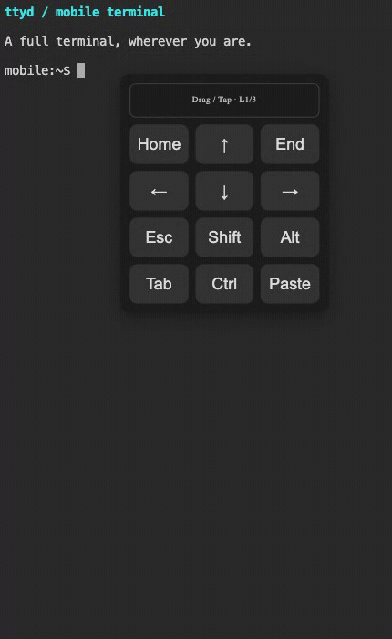
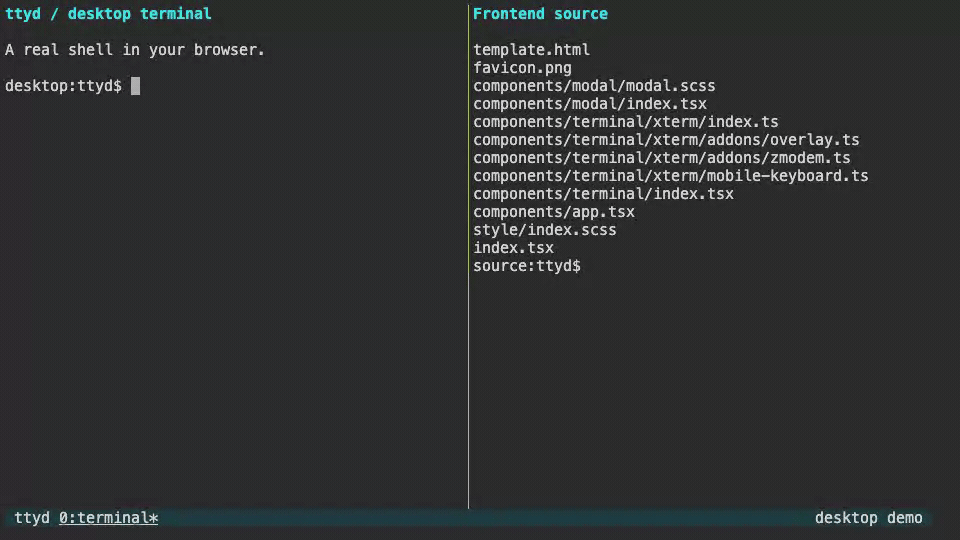

[](https://github.com/tsl0922/ttyd/releases)
[](https://hub.docker.com/r/tsl0922/ttyd)
[](https://repology.org/project/ttyd/versions)


# ttyd - Share your terminal over the web

ttyd is a simple command-line tool for sharing terminal over the web.

## Mobile optimizations (this fork)

This fork of [tsl0922/ttyd](https://github.com/tsl0922/ttyd) focuses on improving the terminal experience on phones and tablets, using a companion [xterm.js fork](https://github.com/someonegg/xterm.js).

- A draggable virtual keypad with switchable layouts, Esc, Tab, arrow keys, and Ctrl / Alt / Shift combinations, plus customizable keys and themes.
- Touch text selection, copy and paste, and a batch input panel for entering commands on mobile devices.
- Improved viewport handling when the on-screen keyboard opens, and tap-to-reconnect support on the disconnect overlay.

See [Usage](#usage) for a complete startup example.



---



# Features

- Built on top of [libuv](https://libuv.org) and [WebGL2](https://developer.mozilla.org/en-US/docs/Web/API/WebGL_API) for speed
- Fully-featured terminal with [CJK](https://en.wikipedia.org/wiki/CJK_characters) and IME support
- [ZMODEM](https://en.wikipedia.org/wiki/ZMODEM) ([lrzsz](https://ohse.de/uwe/software/lrzsz.html)) / [trzsz](https://trzsz.github.io) file transfer support
- [Sixel](https://en.wikipedia.org/wiki/Sixel) image output support ([img2sixel](https://saitoha.github.io/libsixel) / [lsix](https://github.com/hackerb9/lsix))
- SSL support based on [OpenSSL](https://www.openssl.org) / [Mbed TLS](https://github.com/Mbed-TLS/mbedtls)
- Run any custom command with options
- Basic authentication support and many other custom options
- Cross platform: macOS, Linux, FreeBSD/OpenBSD, [OpenWrt](https://openwrt.org), Windows

# Installation

Build this fork from source. The prebuilt mobile frontend is already embedded in `src/html.h`, so no frontend build tools are required.

## Dependencies

You need a C compiler, CMake, Git, and the development libraries for json-c, libuv, zlib, OpenSSL, and libwebsockets. libwebsockets must be built with libuv support (`LWS_WITH_LIBUV=ON`).

On macOS, install the Xcode Command Line Tools (`xcode-select --install`), then install dependencies with Homebrew:

```bash
brew install cmake git json-c libuv libwebsockets openssl@3
```

On Debian/Ubuntu:

```bash
sudo apt update
sudo apt install build-essential cmake git pkg-config libjson-c-dev \
  libuv1-dev zlib1g-dev libssl-dev libwebsockets-dev libwebsockets-evlib-uv
```

## Build and install

```bash
git clone --branch 1.7.7-mobile https://github.com/someonegg/ttyd.git
cd ttyd

cmake -S . -B build -DCMAKE_BUILD_TYPE=Release
cmake --build build --parallel
sudo cmake --install build
```

On macOS, if CMake cannot find Homebrew libraries, add `-DCMAKE_PREFIX_PATH="$(brew --prefix)"` to the configure command.

To run without installing, use `./build/ttyd`. To modify or rebuild the frontend, see [Frontend development](html/README.md). For Windows source builds, see [Compile on Windows](https://github.com/tsl0922/ttyd/wiki/Compile-on-Windows).

# Usage

## Start a terminal

```bash
ttyd --writable --port 7681 \
  --client-option fontSize=15 \
  --client-option focusOnMouseDown=cursor \
  --client-option forceSelection=true \
  --client-option enableMobileKeyboard=true \
  --client-option cursorBlink=true \
  bash
```

Open `http://localhost:7681` in your browser. The same command supports desktop browsers and touch devices:

- `focusOnMouseDown=cursor` focuses terminal input when clicking or tapping near the cursor, making it easier to control when the on-screen keyboard opens.
- `forceSelection=true` allows text selection even when the terminal application enables mouse reporting, such as tmux or Vim.
- `enableMobileKeyboard=true` enables the draggable virtual keypad on touch devices; it stays hidden on desktop browsers without touch input.

`--writable` enables terminal input; ttyd is read-only by default. `focusOnMouseDown` and `forceSelection` are provided by the companion xterm.js fork included in this build.

## Share a persistent tmux session

```bash
ttyd --writable --port 7681 \
  --client-option fontSize=15 \
  --client-option focusOnMouseDown=cursor \
  --client-option forceSelection=true \
  --client-option enableMobileKeyboard=true \
  --client-option cursorBlink=true \
  --client-option enableTrzsz=true \
  --client-option enableSixel=true \
  --client-option disableLeaveAlert=true \
  --client-option disableResizeOverlay=true \
  tmux new-session -A -s web
```

This creates or attaches to the `web` session, keeping your shell running after the browser disconnects. Install tmux separately for this example. `enableTrzsz` and `enableSixel` enable file transfer and image rendering when the corresponding tools are available in the terminal.

## Command-line Options

```
USAGE:
    ttyd [options] <command> [<arguments...>]

OPTIONS:
    -p, --port              Port to listen (default: 7681, use `0` for random port)
    -i, --interface         Network interface to bind (eg: eth0), or UNIX domain socket path (eg: /var/run/ttyd.sock)
    -U, --socket-owner      User owner of the UNIX domain socket file, when enabled (eg: user:group)
    -c, --credential        Credential for basic authentication (format: username:password)
    -H, --auth-header       HTTP Header name for auth proxy, this will configure ttyd to let a HTTP reverse proxy handle authentication
    -u, --uid               User id to run with
    -g, --gid               Group id to run with
    -s, --signal            Signal to send to the command when exit it (default: 1, SIGHUP)
    -w, --cwd               Working directory to be set for the child program
    -a, --url-arg           Allow client to send command line arguments in URL (eg: http://localhost:7681?arg=foo&arg=bar)
    -W, --writable          Allow clients to write to the TTY (readonly by default)
    -t, --client-option     Send option to client (format: key=value), repeat to add more options
    -T, --terminal-type     Terminal type to report, default: xterm-256color
    -O, --check-origin      Do not allow websocket connection from different origin
    -m, --max-clients       Maximum clients to support (default: 0, no limit)
    -o, --once              Accept only one client and exit on disconnection
    -q, --exit-no-conn      Exit on all clients disconnection
    -B, --browser           Open terminal with the default system browser
    -I, --index             Custom index.html path
    -b, --base-path         Expected base path for requests coming from a reverse proxy (eg: /mounted/here, max length: 128)
    -P, --ping-interval     Websocket ping interval(sec) (default: 5)
    -6, --ipv6              Enable IPv6 support
    -S, --ssl               Enable SSL
    -C, --ssl-cert          SSL certificate file path
    -K, --ssl-key           SSL key file path
    -A, --ssl-ca            SSL CA file path for client certificate verification
    -d, --debug             Set log level (default: 7)
    -v, --version           Print the version and exit
    -h, --help              Print this text and exit
```

Read the example usage on the [wiki](https://github.com/tsl0922/ttyd/wiki/Example-Usage).

## Browser Support

Modern browsers, See [Browser Support](https://github.com/xtermjs/xterm.js#browser-support).

## Alternatives

* [Wetty](https://github.com/krishnasrinivas/wetty): [Node](https://nodejs.org) based web terminal (SSH/login)
* [GoTTY](https://github.com/yudai/gotty): [Go](https://golang.org) based web terminal
